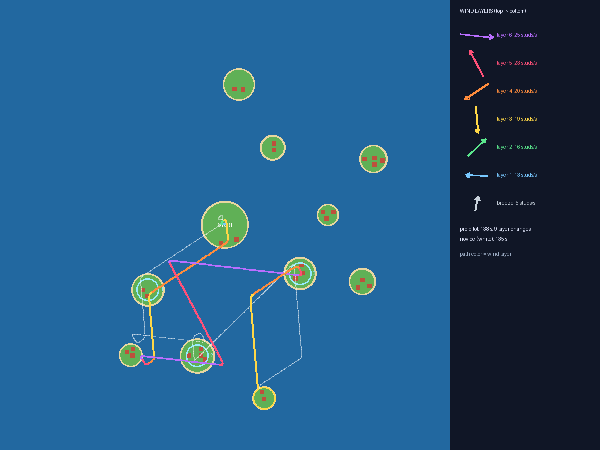

# Ветра (Winds)

Гонки на воздушных шарах для Roblox. У шара **одно управление — ВЫШЕ / НИЖЕ** (горелка и клапан). Небо разрезано на 6 слоёв, и **каждый слой дует в свою сторону**: в каждом летят цветные ленты ветра, у чекпоинтов висят стрелки слоёв, справа на экране — лестница ветров. Хочешь повернуть — найди слой с нужным ветром. Гонка до 12 шаров между островами (пустые места занимают ИИ-соперники), между гонками — доставка посылок на крыши: посылку сносит ветрами, пока она падает.

Дизайн-документ: [`docs/DESIGN.md`](docs/DESIGN.md) · Плейтест: [`docs/PLAYTEST.md`](docs/PLAYTEST.md) · Публикация и монетизация: [`docs/PUBLISH.md`](docs/PUBLISH.md) · Локальная сессия Claude + Studio MCP: [`docs/LOCAL_SESSION.md`](docs/LOCAL_SESSION.md)



*Архипелаг seed 3, сгенерирован тем же кодом, что и в игре.* Кольца — чекпоинты (F — финиш). Цветная линия — путь ИИ-пилота: цвет = слой ветра, в котором он летел (9 смен слоя за гонку). Белая тонкая — путь «новичка». Справа — куда дует каждый слой.

Всё построено кодом из примитивов: острова, дома, маяки, шары (оболочка из дисков), интерфейс. Сторонних моделей нет. Архипелаг — новый на каждом сервере, ветра — новые к каждой гонке.

---

## Как запустить в Roblox Studio (Windows)

### Один раз
Rokit и плагин Rojo уже стоят после прошлых игр. Если нет — см. README репозитория `roblox`.
```powershell
cd "D:\programming\projects\2.IntelliJ_IDEA\Java"
git clone https://github.com/covest2051/roblox-winds.git
cd roblox-winds
git checkout claude/roblox-winds-game-9lrnhx
rokit install
```

### Поиграть
```powershell
git pull
rojo build -o game.rbxl
```
Открой `game.rbxl` в Studio (File → Open from File), включи **View → Output**, нажми **Play** (F5).

### Живая синхронизация кода
Открой `game.rbxl`, запусти `rojo serve` (окно не закрывать), в Studio: **Plugins → Rojo → Connect**.

### Мультиплеер в Studio
Вкладка **Test → Clients and Servers** → 2 игрока → **Start**. Так проверяется главное: чужой шар двигается плавно, его пламя и ленты видны, гонка идёт для обоих.

## Управление
| ПК | Телефон | Что делает |
|---|---|---|
| **W** / Пробел / ↑ (держать) | кнопка **▲ ВЫШЕ** | горелка: вверх 18 studs/s |
| **S** / Ctrl / ↓ (держать) | кнопка **▼ НИЖЕ** | клапан: вниз 18 studs/s |
| ничего не нажато | | шар держит высоту и летит по ветру своего слоя |
| мышь (правая кнопка) / колесо | палец по экрану | камера; стрелки на лестнице ветров поворачиваются вместе с ней |
| | Участвую ✓ | участвовать в ближайшей гонке (по умолчанию да) |
| | Другой заказ | сменить крышу доставки |
| | Магазин, «+», Позвать друзей | косметика, сундук с шансами, пропуска |
| | DBG (только Studio) | гонка сейчас, к чекпоинту, к финишу, в море, к заказу, новые ветра, монеты, RU/EN |

---

## Для разработки

### Структура
```
src/shared/      логика без инстансов: тестируется в Lune
  Config         все числа баланса и ID товаров
  Winds          слои ветра из seed («роза» без дыр, соседние слои — разные), размытие границ
  World          архипелаг из seed: острова, дома, маяки, высота поверхности; трасса и старт
  Flight         физика шара (горелка/клапан, ветер слоя, земля, вода, потолок)
  Parcel         падение посылки со сносом по слоям, попадание на крышу
  Pilot          «голова» пилота: ИИ-соперники в игре и боты в тестах
  Race, Delivery гонка и заказы целиком
  Catalog        косметика (шар, ленты, след), точные шансы сундука
  Profile        данные игрока: покупки, статистика, журнал чеков
  Rewards, Strings
src/server/      архипелаг (WorldBuilder), шары (BalloonBuilder, FlightService — проверка скорости,
                 «намок»), гонки и ИИ (RaceService), доставки (DeliveryService), данные, покупки,
                 косметика, запросы (Actions), SelfTest
src/client/      Controls (свой шар: Flight → LinearVelocity), WindFx (ленты ветра, ленты на корзинах,
                 пламя, чекпоинты, метка падения), Hud (лестница ветров, кнопки), Shop, Fx, DebugPanel
tests/           *.spec.luau — тесты логики, отклика и баланса; lib/Bots — боты на голове Pilot
tests/engine/    прогон собранного place на «заглушке» движка (сервер и клиент)
scripts/         проверка place, проверка API по дампу Roblox, картинка карты, check.sh
```

### Проверки
```bash
./scripts/check.sh            # всё сразу: формат, линтер, тесты, сборка, прогоны на заглушке
```
С проверкой API (дамп берётся с GitHub):
```bash
curl -sSfLo API-Dump.json https://raw.githubusercontent.com/MaximumADHD/Roblox-Client-Tracker/roblox/API-Dump.json
API_DUMP=API-Dump.json ./scripts/check.sh
```
Что проверяется:
- `tests/flight.spec` — **отклик**: половина скорости за 0,2 с, шар держит высоту без кнопок, от нажатия до поворота на ветер соседнего слоя — в среднем 1,6 с, худший 1,8 с (60 наборов ветров), обрыв останавливает шар, море — «намок»;
- `tests/winds.spec` — 300 наборов: любое направление ближе 45° к какому-то слою, соседние слои отличаются ≥ 50°, выше — быстрее, ветер непрерывен по высоте;
- `tests/world.spec` — острова не налезают, дома на плато, крыши совпадают с моделью, трассы поворачивают, 12 шаров помещаются на старте;
- `tests/race.spec` — **баланс на ботах**: пилот финиширует 30/30 за ~2 мин и меняет слой ~7 раз; новичок с реакцией 0,8 с — 20/20; не меняющий высоту — 0/12; меняющий наугад — 0/12; каждый слой полезен;
- `tests/parcel.spec` — снос посылки складывается из слоёв, край крыши засчитывается, боты доставляют 45/45 (медиана ~50 с);
- `tests/catalog.spec`, `profile.spec`, `strings.spec` — шансы ровно 100%, дубликаты, покупки, RU/EN;
- `tests/engine/server_sim` — боты **летают шарами игроков** по настоящему серверу: доставка на крышу, проверка скорости, «намок», гонка с ИИ до итогов и монет, отказ от гонки, косметика на шаре, пропуска, PolicyService, идемпотентность чеков, сбой DataStore;
- `tests/engine/client_sim` — W → скорость вверх в том же кадре, поворот на новый слой за 1,3 с (ленты на корзине — раньше шара), кнопки телефона, лестница ветров поворачивается с камерой, ленты ветра в каждом слое, метка падения, гонка (отсчёт, подсветка чекпоинта, таблица, итоги), магазин с шансами, регион без сундука.

### Картинка карты
```bash
lune run scripts/export_map.luau 3 build/map.json
python3 scripts/render_map.py build/map.json docs/img/map.png
```

### Где менять баланс
`src/shared/Config.luau`: слои (`Wind`: толщина, скорости, разброс направлений), отклик шара (`Flight`: `Climb`, `TauV`, `TauH`), трасса (`Race`), посылки (`Parcel`), награды (`Rewards`), ИИ (`Ai`). После правки — `lune run tests/run.luau`: тест отклика скажет, если управление стало «ватным», тест баланса — если трассу нельзя пройти или можно пройти без смены слоёв.
